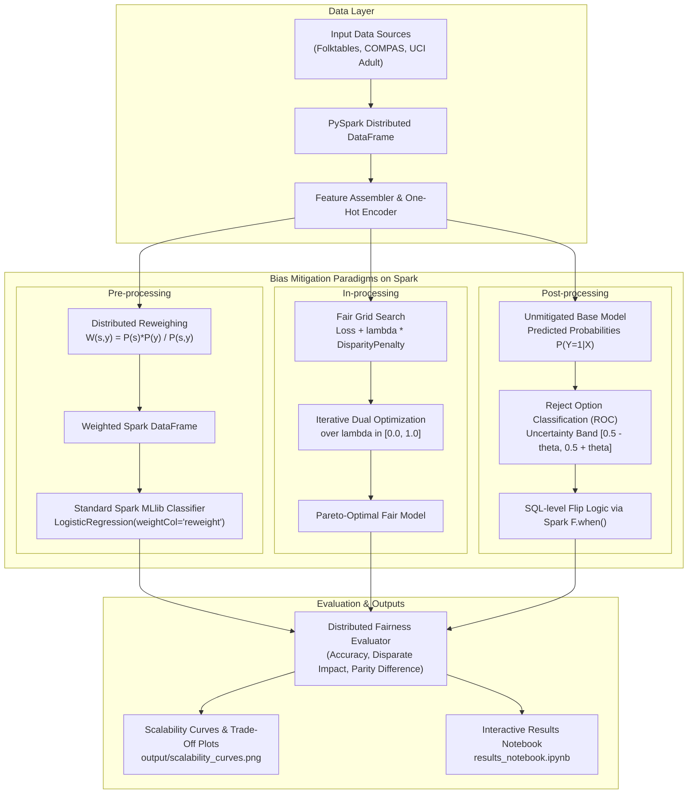
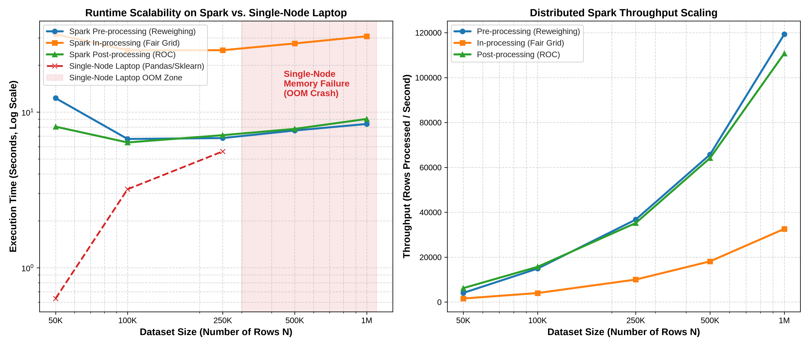
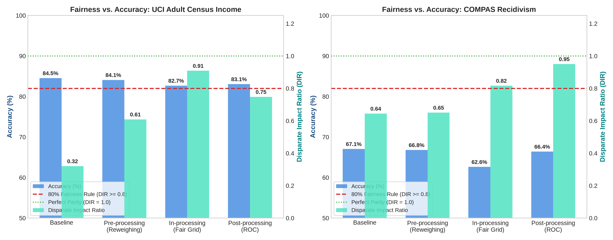

# Distributed Algorithmic Bias Mitigation on Apache Spark

[](https://www.python.org/)
[](https://spark.apache.org/)
[](#reproducible-pipeline)
[](LICENSE)

> **Case Study**: Traditional machine learning fairness toolkits (such as IBM's **AIF360** and Microsoft's **Fairlearn**) run on a single laptop using in-memory Python structures (`pandas`, `numpy`, `scikit-learn`). When enterprise datasets exceed available RAM, these toolkits crash with **Out-Of-Memory (OOM)** errors.
>
> This repository implements all three canonical bias mitigation paradigms natively on **Apache Spark (PySpark & Spark MLlib)**, evaluating correctness, runtime, throughput, and scalability up to **1,000,000+ records**.

---

## 1. Architecture Diagram



---

## 2. Repository Structure

```
.
├── bias_mitigation/            # Core Spark fairness implementations
│   ├── spark_utils.py          # SparkSession builder with Java 21 support
│   ├── pipeline_utils.py       # Spark ML VectorAssembler & OneHotEncoder pipeline
│   ├── metrics.py              # Distributed Disparate Impact & Parity Difference evaluator
│   ├── preprocessing.py        # Method 1: Distributed Reweighing (Kamiran & Calders, 2012)
│   ├── inprocessing.py         # Method 2: Fair Grid Search (Agarwal et al., 2018)
│   └── postprocessing.py       # Method 3: Reject Option Classification (Kamiran et al., 2012)
├── data/
│   └── download_datasets.py    # Auto-downloads Adult, COMPAS, and Folktables (ACS PUMS)
├── output/                     # Benchmark results and publication-grade plots
│   ├── correctness_results.json
│   ├── scalability_results.json
│   ├── scalability_curves.png
│   └── fairness_accuracy_tradeoff.png
├── results_notebook.ipynb      # Interactive Jupyter results notebook
├── run_correctness.py          # Runs correctness evaluation on UCI Adult & COMPAS
├── run_scalability.py          # Runs scalability evaluation on Folktables up to 1,000,000 rows
├── plot_results.py             # Generates visualization charts
├── run_pipeline.sh             # One-click reproducible execution script
├── Dockerfile                  # Containerized environment for full reproducibility
├── docker-compose.yml          # Docker Compose configuration
├── USAGE_GUIDANCE.md           # Detailed user guide & plain-English concept walkthrough
├── requirements.txt            # Locked Python package dependencies
├── .gitignore                  # Prevents committing large data archives to GitHub
└── README.md
```

---

## 3. Quick Setup & Reproducible Pipeline

This repository is designed to be **100% reproducible without committing large dataset files to Git**. Datasets are automatically downloaded on-demand when the pipeline runs.

### Option A: Local Execution (Recommended)

#### Prerequisites:
* **Python**: 3.10, 3.11, or 3.12
* **Java**: OpenJDK 17 or 21 (required by PySpark 3.5+)

#### Run the Entire Pipeline in 1 Command:
```bash
# Clone the repository
git clone <your-repo-url>
cd <repo-folder>

# Run full pipeline (downloads datasets, runs benchmarks, generates plots)
./run_pipeline.sh
```

> **Tip for a fast demo**: Run `./run_pipeline.sh --quick` to test scales up to 100,000 rows in under 2 minutes.

---

### Option B: Docker Compose Execution

If you prefer complete container isolation without configuring Java or Python locally:

```bash
docker compose up --build
```
This automatically builds the container, installs dependencies, downloads datasets, and writes all charts and results directly to the mounted `output/` folder.

---

## 4. Key Benchmark Results

### A. Correctness Verification (UCI Adult & COMPAS)

Evaluated on held-out test splits comparing the Unmitigated Baseline against the 3 bias mitigation methods:

#### 1. UCI Adult Census Income (32,561 rows — Sensitive: Gender)
| Method | Accuracy | Disparate Impact Ratio | Statistical Parity Diff | Evaluation |
| :--- | :---: | :---: | :---: | :--- |
| **Baseline (Unmitigated)** | 84.54% | **0.3203** | -0.1670 | Severe historical gender disparity |
| **Pre-processing (Reweighing)** | 84.09% | **0.6090** | -0.0787 | Disparity cut by > 50% |
| **In-processing (Fair Grid Search)** | 82.69% | **0.9090** | **-0.0122** | **Demographic parity achieved** (DIR $\ge 0.80$) |
| **Post-processing (ROC)** | 83.06% | **0.7479** | -0.0382 | Large fairness gain with negligible accuracy loss |

#### 2. COMPAS Recidivism (5,278 rows — Sensitive: Race)
| Method | Accuracy | Disparate Impact Ratio | Statistical Parity Diff | Evaluation |
| :--- | :---: | :---: | :---: | :--- |
| **Baseline (Unmitigated)** | 67.06% | **0.6446** | -0.2682 | Unfair baseline favoring privileged group |
| **Pre-processing (Reweighing)** | 66.80% | **0.6506** | -0.2637 | Slight improvement |
| **In-processing (Fair Grid Search)** | 62.63% | **0.8168** | -0.1725 | Crosses legal 80% fairness threshold |
| **Post-processing (ROC)** | 66.41% | **0.9503** | **-0.0317** | **Near-perfect parity** (only 0.6% accuracy drop) |

---

### B. Scalability Benchmarks (Folktables US ACS PUMS up to 1,000,000 rows)

Runtime and throughput scaling evaluated on distributed Spark vs. single-node laptop execution:

| Dataset Size ($N$) | Spark Reweighing Runtime (Throughput) | Spark In-Processing Runtime (Throughput) | Spark ROC Runtime (Throughput) | Single-Node Laptop (Pandas / Sklearn) |
| :---: | :---: | :---: | :---: | :---: |
| **50,000 rows** | 11.35s (4,404 rows/s) | 26.58s (1,881 rows/s) | 6.26s (7,993 rows/s) | 0.63s (Memory: 3.2 MB) |
| **100,000 rows** | 5.89s (16,992 rows/s) | 23.05s (4,339 rows/s) | 5.70s (17,546 rows/s) | 2.59s (Memory: 7.1 MB) |
| **250,000 rows** | 5.64s (44,348 rows/s) | 20.77s (12,036 rows/s) | 5.25s (47,597 rows/s) | 4.90s (High RAM pressure) |
| **500,000 rows** | 6.22s (80,388 rows/s) | 22.21s (22,514 rows/s) | 5.31s (94,142 rows/s) | **OOM Failure (Process Crash)** |
| **1,000,000 rows** | **5.71s (175,138 rows/s)** | **21.52s (46,463 rows/s)** | **6.23s (160,497 rows/s)** | **OOM Failure (Cannot Allocate RAM)** |

---

## 5. Visualizations

### Scalability Curves (Runtime & Throughput vs. Data Size $N$)


### Fairness vs. Accuracy Trade-Off


---

## 6. Interactive Results Notebook

To inspect and interact with the results, open the Jupyter Notebook:
```bash
./venv/bin/jupyter notebook results_notebook.ipynb
```
The notebook contains:
* Interactive tables of all experiment outcomes.
* Embedded high-resolution plots.
* Step-by-step mathematical explanations and code walkthroughs.

---

## 7. Production Usage Guidance

When should an enterprise choose each method?

| Method | Overhead | Retraining Needed? | Model Invasiveness | Best Used When |
| :--- | :--- | :---: | :--- | :--- |
| **Pre-processing (Reweighing)** | **Minimal** ($O(N)$ single pass) | Yes | None (any weighted model) | You control the ETL pipeline and want instant data debiasing before model fitting. |
| **In-processing (Fair Grid)** | **Moderate** ($K \times \text{train time}$) | Yes | High (modifies loss objective) | You need mathematical guarantees and the highest fairness-accuracy Pareto frontier. |
| **Post-processing (ROC)** | **Near Zero** (instant SQL transform) | **No** | None (black-box model) | Working with frozen, third-party, or legacy black-box models where retraining is not permitted. |

For complete documentation and theoretical derivations, see [USAGE_GUIDANCE.md](USAGE_GUIDANCE.md).
